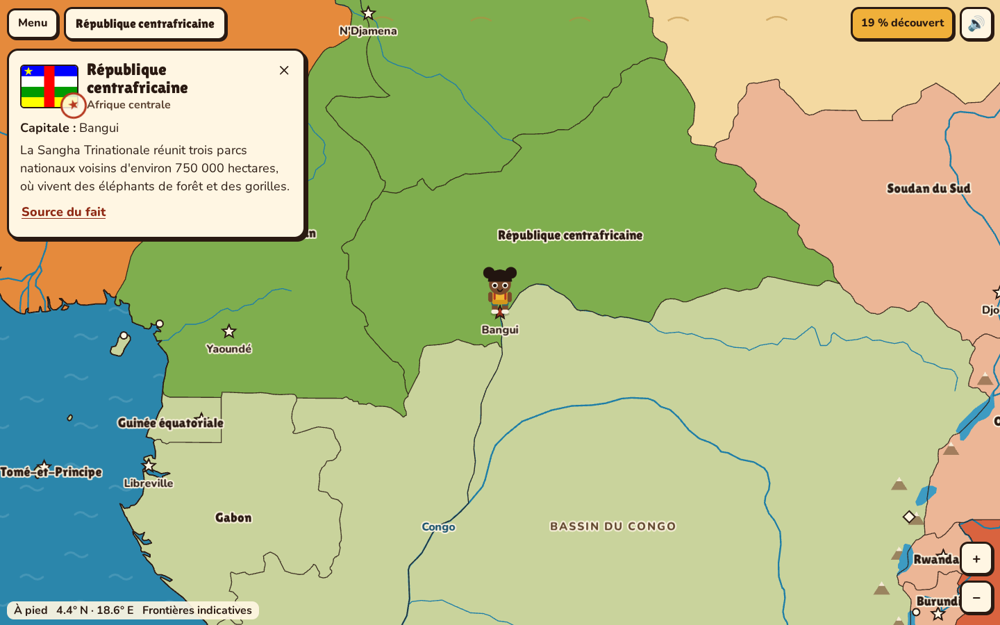
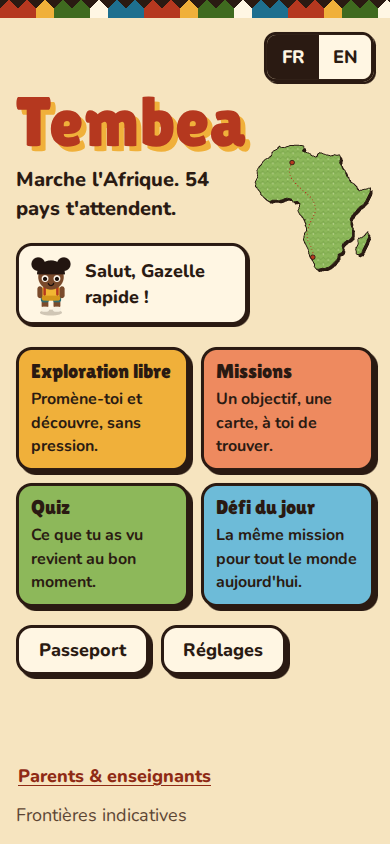
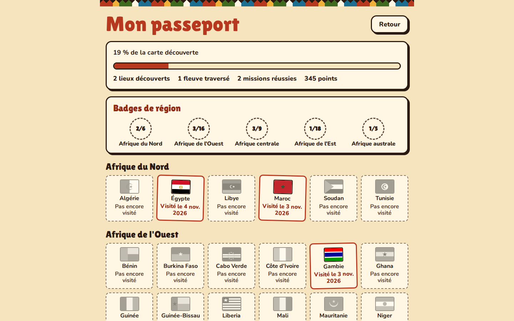
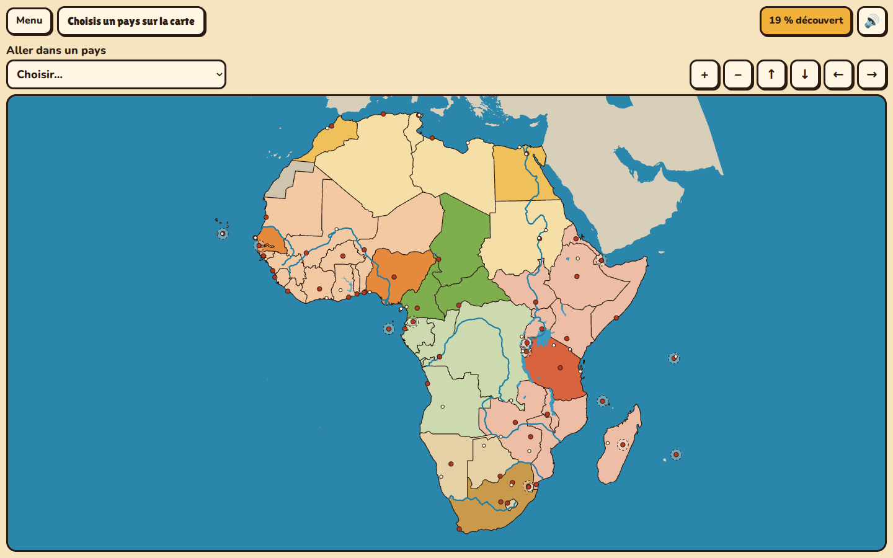
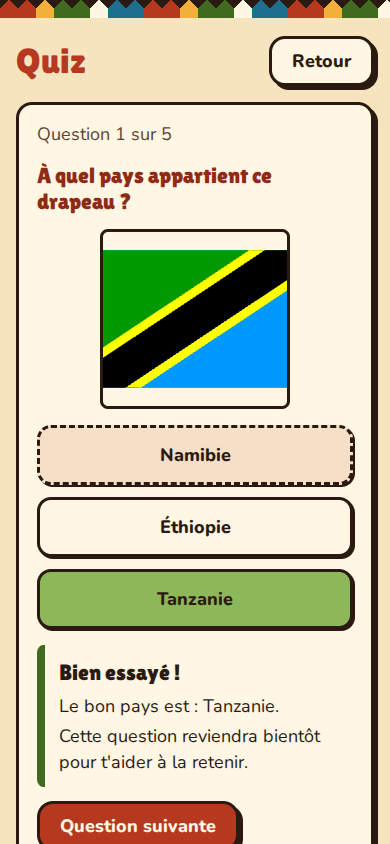
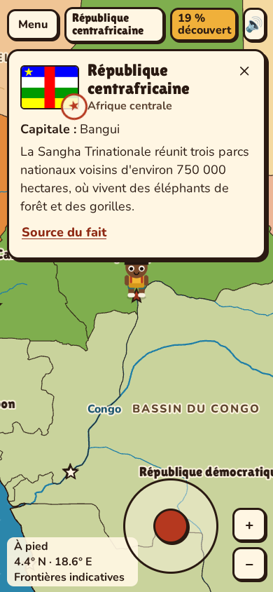

# Tembea

**Marche l'Afrique. 54 pays t'attendent.**

Tembea (« marcher, voyager » en swahili) est un jeu de géographie pour les 8–15 ans. Un personnage parcourt à pied et en pirogue une vraie carte de l'Afrique pour découvrir ses pays, ses capitales, ses fleuves, ses lacs et ses reliefs. Pas de compte, pas de publicité, pas de traceur : tout reste sur l'appareil.

| Exploration                                                                             | Accueil                                                         | Passeport                                                             |
| --------------------------------------------------------------------------------------- | --------------------------------------------------------------- | --------------------------------------------------------------------- |
|  |  |  |

| Carte à cliquer                                          | Quiz                                                               | Mobile                                                                   |
| -------------------------------------------------------- | ------------------------------------------------------------------ | ------------------------------------------------------------------------ |
|  |  |  |

Captures réelles du build local.

## Jouer en local

Il faut Node 22 et pnpm 11.

```bash
pnpm install
```

```bash
pnpm build && pnpm preview
```

Puis ouvrir http://localhost:4173.

## Le jeu

- **Exploration libre :** flèches ou WASD, joystick sur mobile. L'océan se traverse en pirogue, jusqu'aux six pays insulaires.
- **Missions :** va à une capitale, traverse un fleuve, trouve un pays sans accès à la mer, rejoins une île. Chronomètre facultatif.
- **Quiz :** les questions viennent de ce que tu as visité. Les erreurs reviennent par répétition espacée (Leitner), sans sanction.
- **Défi du jour :** même mission pour tous, déduite de la date UTC, score local.
- **Deux niveaux :** Explorateur (8–11 ans) et Géographe (12–15 ans).
- **Progression :** passeport à tampons, badges des cinq régions M49, pourcentage de carte découverte.
- **Accessibilité :** clavier complet, mode sans déplacement avec carte SVG, police pour la dyslexie, réduction des animations.
- **Hors ligne :** PWA, jouable sans réseau après le premier chargement.

## Scripts

| Commande                          | Rôle                                                                       |
| --------------------------------- | -------------------------------------------------------------------------- |
| `pnpm dev`                        | Serveur de développement                                                   |
| `pnpm build`, `pnpm preview`      | Build de production et prévisualisation avec les en-têtes de `vercel.json` |
| `pnpm verify`                     | Lint, types, tests et couverture, données, build, budget, e2e, audit       |
| `pnpm lighthouse`                 | Scores Lighthouse, échoue sous 90                                          |
| `pnpm perf`                       | Proxy FPS (ce n'est pas une mesure sur appareil réel)                      |
| `pnpm data:build`                 | Régénère les données depuis Natural Earth                                  |
| `pnpm data:review`                | Régénère `docs/REVIEW_FACTS.md`                                            |
| `pnpm assets`, `pnpm screenshots` | Icônes et captures                                                         |

## Architecture

```
src/core/    logique pure : monde, déplacement, missions, quiz, Leitner, défi
src/data/    chargement, validation Zod, repositories localStorage
src/render/  PixiJS, chargé à la demande
src/ui/      React : écrans, HUD, carte SVG, store Zustand
src/i18n/    français et anglais
data/        capitales, régions, faits et lieux curatés
scripts/     pipeline de données, budget, Lighthouse, FPS
```

`core/` ne dépend ni de PixiJS, ni de React, ni du DOM (règle ESLint). La carte Pixi et la carte SVG émettent les mêmes événements : les missions fonctionnent à l'identique dans les deux modes. Les choix sont expliqués dans `docs/PLAN.md` et `docs/adr/`.

## État du projet

Prototype local, jamais déployé. Avant une mise en ligne :

- les faits sont des brouillons d'IA à relire : `docs/REVIEW_FACTS.md` ;
- l'analyse RGPD et COPPA (`docs/adr/0004-mineurs-rgpd-coppa.md`) n'est pas un avis juridique ;
- la fluidité n'a pas été mesurée sur un vrai téléphone : `docs/BLOCKERS.md`.

La suite est dans `docs/ROADMAP.md`, le déploiement dans `docs/DEPLOY.md`.

## Licences

Code sous licence MIT (`LICENSE`). Les données et les polices gardent leur licence : voir `ATTRIBUTIONS.md`.
